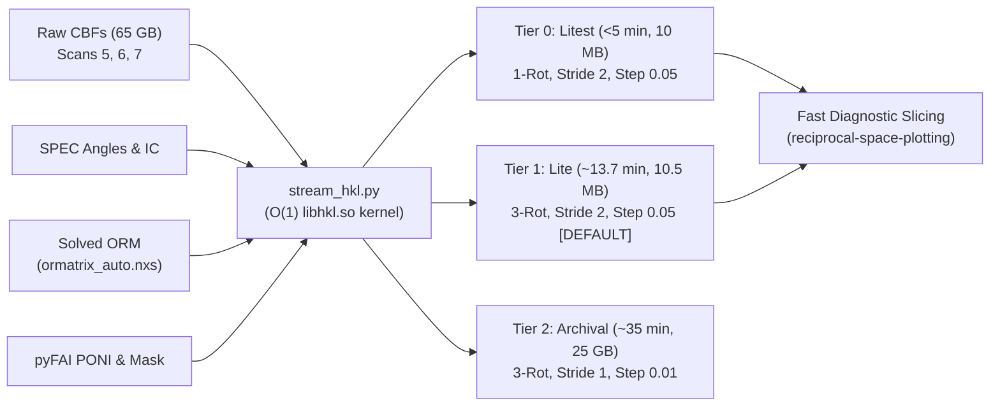

# CHESS Reciprocal Space Reduction & Streaming Pipeline Skill (`chess-legacy-reduction`)

This skill defines the operational standards, path conventions, cluster etiquette, and execution procedures for automating the legacy "CHESS" data reduction workflow for the QM2 beamline.

---

## 1. Remote Compute Etiquette & Python Environment

### 1.0 First-Use SSH Access Check (Mandatory Pre-Flight)
Before the first remote reduction task, establish the user's CLASSE username and login host (`lnx201.classe.cornell.edu`). Test an existing connection with `BatchMode=yes` and a short connection timeout:
```bash
ssh -o BatchMode=yes -o ConnectTimeout=15 <username>@lnx201.classe.cornell.edu 'echo CHESS_SSH_OK'
```
*(On Windows PowerShell: `ssh -o BatchMode=yes -o ConnectTimeout=15 "${classeUser}@lnx201.classe.cornell.edu" 'echo CHESS_SSH_OK'`)*.

If unattended authentication fails:
1. Explain that a password or Duo login in a separate terminal will **not** automatically authenticate later commands run by the agent or background subprocesses.
2. Offer to set up a dedicated local Ed25519 SSH key (`~/.ssh/id_ed25519_classe`), or use another authentication method approved by the facility. Consult the [SSH First-Time Setup & Non-Interactive Access Guide](references/ssh-first-use.md) before creating a key or installing its public half.
3. Obtain the user's choice of passphrase protection. Prefer an existing, supported SSH agent for a protected key; use a key without a passphrase only when the user explicitly chooses that option. Reuse suitable existing keys and configuration rather than overwriting them.
4. Keep the private key on the user's computer. Install only the public key on the user's remote account, preserving all existing authorized-key entries. Have the user enter any password or second factor directly in an interactive terminal, rather than in chat or a script. (For Windows users, use the safe Base64-encoded installation script in the guide to avoid PowerShell quoting bugs and CRLF line ending corruption).
5. Complete setup only after a fresh `BatchMode=yes` connection succeeds and returns `CHESS_SSH_OK`. Key creation, an installation-success message, or a working interactive login alone is insufficient.
6. Once access is verified, resume the user's scientific task immediately. SSH authentication does not replace compute-node allocation rules or any required job-submission approval.

### 1.1 Execution Protocols & Cluster Etiquette
1. **Execution Architecture: Batch Reduction (`qsub`) vs. Interactive Sessions (`qrsh`)**:
   - **Data Reduction Pipeline (Mandatory `qsub` via Bash Wrappers)**: All heavy reduction tasks (Pilatus raw CBF stacking into `stack*.nxs`, headless ORM solving with basinhopping, and 1rot/3rot reciprocal space conversions) **MUST be submitted as Grid Engine `qsub` jobs**:
     ```bash
     qsub -q 'all.q@lnx307*,all.q@lnx311*,all.q@lnx312*,all.q@lnx313*' -l mem_free=200G -pe sge_pe 32 <path-to-submission-script>.sh
     ```
     - **Execution Pattern**: Reduction jobs are driven by submitting an SGE bash wrapper script (see templates in [`example_job_scripts/`](../example_job_scripts/)) to `qsub`. Inside the job script on the allocated worker node, `orchestrate_reduction.py` executes each reduction step using unbuffered Python (`python -u`).
     - **Real-Time Monitoring**: Users monitor live reduction progress from `lnx201` by streaming the output log defined in the job script (`#$ -o <path_to_log>`):
       ```bash
       tail -f /nfs/chess/id4baux/{cycle}/{experiment}/scripts/{sample_id}/qsub_batch.log
       ```
     - > [!IMPORTANT]
     - > **Stack Loading I/O Latency & Memory Demands**:
     - > Data stacks (`stack*.nxs`) are 10–35+ GB each. Loading a stack into memory over NFS takes **tens of minutes** and consumes high memory bandwidth and RAM.
     - > **Never run stack-loading or reciprocal conversion scripts interactively over SSH**. Always submit via `qsub`.
   - **Interactive Analysis Sessions (Mandatory `qrsh`)**:
     - Lightweight downstream tasks using `nxs_analysis_tools` (generating diagnostic 2D slices with `plot_slice()`, extracting linecuts with `Scissors`, calculating order parameters, or compiling LaTeX summaries) operate on already-converted volumes using lazy loading ($O(1)$ memory).
     - **Mandatory Interactive Session Protocol**:
       1. Login to the login node: `ssh <username>@lnx201.classe.cornell.edu`
       2. Request an interactive shell allocation:
          ```bash
          qrsh -q interactive.q -l mem_free=350G
          ```
       3. Activate the appropriate Python environment (`/nfs/chess/sw/anaconda3_sgomezalvarado_nightly/bin/python`) on the allocated host. Never run compute directly on `lnx201` and do not SSH directly into compute nodes like `lnx308`.
   - > [!WARNING]
   - > **AVX2 Vector Instruction Requirement & Node Compatibility (Exit Code -4 / SIGILL)**:
   - > The shared C library `libhkl.so` in `chess_legacy_codebase/` was compiled with **AVX2 vector instructions**.
   - > If a job is dispatched to older compute nodes in `all.q` that lack AVX2 (e.g. `lnx327` with Ivy Bridge Xeon E5-2660 v2), the CPU raises an invalid opcode trap (`traps: python invalid opcode in libhkl.so`), instantly killing the process with **exit code `-4` (`SIGILL`)**.
   - > Always restrict `all.q` to verified AVX2-capable nodes using host wildcards:
   - > `-q 'all.q@lnx307*,all.q@lnx311*,all.q@lnx312*,all.q@lnx313*'`
   - > Known verified AVX2 hosts: `lnx307` (Broadwell), `lnx311`, `lnx312`, `lnx313` (Skylake Gold 6130).

2. **Mandatory "Show-Before-Submit" Verification Gate**:
   - > [!IMPORTANT]
   - > Prior to executing `qsub <job_script>.sh` for either fast-path reference solving or full batch reduction, the assistant **MUST present the complete script text to the user** in the chat, highlighting the queue targets, memory requests, slot allocations, environment path, and CLI invocation. The assistant must obtain explicit user confirmation before issuing the `qsub` command.

3. **Login Node Etiquette**:
   - **`lnx201`** is a **login node** only. Never execute data reduction jobs or heavy analysis directly here.
   - Text editing, git operations, checking logs, `tail -f`, and monitoring `qstat` are the only activities permitted on `lnx201`.

4. **Designated Python Environments & Absolute Immutability**:
   - Per [`GEMINI.md`](../GEMINI.md), all cluster environments under `/nfs/chess/sw/` are strictly **read-only / immutable**. Never run `pip install` or modify environment files. If an import fails, halt and report to the user immediately.
   - **Legacy Reduction Pipeline (`PYTHON_EXEC`)**: All raw beamline stacking, ORM solving, and C-extension conversions (`libhkl.so`) strictly execute with:
     ```bash
     /nfs/chess/sw/anaconda3_jpcr/bin/python
     ```
   - **Modern Analysis & Visualization (`NIGHTLY_PYTHON` / `VIS_PYTHON`)**: All post-conversion slicing, reciprocal volume visualization, and `plot_slice()` rendering strictly execute with:
     ```bash
     /nfs/chess/sw/anaconda3_sgomezalvarado_nightly/bin/python
     ```
     The diagnostic visualizer (`slice_visualizer.py`) automatically re-executes itself inside this environment to leverage `nxs_analysis_tools.plot_slice()` with dynamic crystallographic skew angles (e.g. `skew_angle=60°` for hexagonal $HK$). All diagnostic slice plots enforce default integer-aligned ticks and crystallographic grid lines reflecting the exact `skew_angle`.
4. **Headless Execution**:
   - Always set `matplotlib.use("Agg")` prior to importing `pyplot` to prevent display connection errors during remote runs.
5. **NeXus Memory Configuration**:
   - NeXus default memory slab limit is 2,000 MB. In all scripts handling stacks or 3D volumes, raise the limit immediately:
     ```python
     import nexusformat.nexus as nx
     nx.nxsetmemory(100000)  # 100 GB
     ```
6. **Real-Time Log Streaming & Unbuffered Execution (`python -u`)**:
   - Long-running reduction and conversion jobs (which process thousands of frames over 30–60+ minutes) must always be executed in unbuffered mode (`/nfs/chess/sw/anaconda3_jpcr/bin/python -u`).
   - Orchestrator wrappers must never use `subprocess.run(stdout=subprocess.PIPE)`, which traps stdout in memory until exit. Always use `subprocess.Popen` with line-by-line streaming and `flush=True` so that real-time progress updates (e.g. `Loaded frame X...`) stream immediately to cluster log files for user inspection.
7. **Strict Data Safety: NEVER Delete Any `.nxs` Files**:
   - > [!CAUTION]
   - > **Mandatory Data Protection Policy**: Under no circumstances should the agent or user delete, remove (`os.remove`, `rm`), or overwrite any `.nxs` files (`stack*.nxs`, `ormatrix_*.nxs`, `1rot_hkli*.nxs`, `3rot_hkli*.nxs`, etc.).
   - > Synchrotron raw CBF stacks and reciprocal space volumes represent irreplaceable beamtime and compute resources.
   - > **Automatic Integer Suffixing**: The legacy reduction scripts (`Pil6M_HKLConv_3D_2022_1rot.py` and `3rot.py`) natively check `while os.path.exists(workingdir + file_name):` and automatically append an integer suffix (`1rot_hkli_1.nxs`, `1rot_hkli_2.nxs`, etc.) if a target file already exists.
   - > If re-running conversion with different limits or forced modes (`--force-hkl`), always allow the pipeline to generate a newly suffixed file rather than deleting prior reconstructions.
8. **Mandatory Lazy Slicing Protocol (No Eager Full-Volume Reads)**:
   - Accessing hierarchical NeXus attributes (such as `data = nx_obj.entry.data` or `counts = data.counts`) is purely a lazy tree traversal that maintains `_value = None` without loading array data into RAM.
   - Slicing 3D reciprocal space volumes for cross-sectional visualization or diagnostic cuts must strictly be performed lazily via hyperslab indexing (e.g. `counts[:, :, slice_span]` or `data[:, :, 0.0]`), reading only the targeted 2D hyperslab directly from disk via HDF5 chunking.
   - **Never** call `.nxdata` or `np.asarray` on an unsliced 3D dataset, and never pass an unsliced 3D `NXdata` to `plot_slice(data, sum_axis=...)` (which triggers `raw_data = data.nxsignal.nxdata` internally, causing out-of-memory aborts on cluster nodes).
9. **Predicted Finish-Time Job Monitoring & Wakeup Protocol**:
   - **Prohibition on Fixed/Arbitrary Interval Timers**: Never schedule check timers using arbitrary, fixed intervals (such as blind 15-minute or 30-minute intervals). Arbitrary intervals wake the agent up prematurely or mid-computation without providing meaningful completion milestones.
   - **Dynamic Rate Estimation**: The agent must dynamically calculate the predicted finish time based on the measured execution rate of the running step:
     - *CBF Stacking*: Compute rate from loaded frames: $\text{rate} = \Delta N / \Delta t \approx 2\text{--}3\text{ frames/s}$. Estimate remaining time:
       $$\Delta t_{\text{est}} = \frac{N_{\text{frames, remaining}}}{\text{rate}} + t_{\text{write}}$$
     - *Reciprocal Space Conversion (`1rot` / `3rot`)*: Measure the exact duration of the first rotation from log timestamps ($T_{\text{rot1}}$, e.g. $\sim 2260\text{ s} \approx 38\text{ min}$ for 3651 frames). Calculate remaining time for the remaining rotations ($N_{\text{rot, remaining}}$) plus downstream visualization:
       $$\Delta t_{\text{est}} = (N_{\text{rot, remaining}} - 1) \times T_{\text{rot1}} + \frac{N_{\text{frames, rot\_curr, remaining}}}{\text{rate}} + t_{\text{slice\_vis}}$$
   - **Targeted One-Shot Schedule**: Set a single-shot timer (`schedule` with `DurationSeconds = int(delta_t_est)`) timed specifically for the predicted finish time. This ensures wakeups occur precisely when the step or entire reduction finishes, eliminating redundant wakeups and unnecessary cluster polling.

---

## 2. Directory Conventions & File Discovery

Standard path patterns at CHESS ID4B:

- **Raw CBF Frames**:
  `/nfs/chess/id4b/{cycle}/{experiment-name}/raw6M/{sample_name}/{sample_id}/{temp}/{scan_folder}/`
  *Frames:* e.g. `FeTe2_PIL10_046_00000.cbf`, ...
- **Processed Data Output**:
  `/nfs/chess/id4baux/{cycle}/{experiment-name}/processed_old_way/{sample_name}/{sample_id}/{temp}/`
  *Outputs:* `stack1.nxs`, `unitcell.txt`, `ormatrix_auto.nxs`, `1rot_hkli.nxs`, `3rot_hkli.nxs`.
  *Note on Pipeline Hierarchy:* Always evaluate the two-level sample leaf `{sample_name}/{sample_id}/` (e.g. `FeTe2/FeTe2-5A`). A material category (`FeTe2/`) may simultaneously exist under `nxrefine/` and `processed_old_way/` for different sample mounts.
- **SPEC Data File**:
  `/nfs/chess/id4b/{cycle}/{experiment-name}/{sample_name}` (e.g. `/nfs/chess/id4b/2026-2/gomez-al-4850-a/FeTe2`)
- **Calibration Geometry & Masks**:
  `/nfs/chess/id4baux/{cycle}/{experiment-name}/calibrations/` (`.poni` and `.edf` masks)
- **Cluster Submission Scripts**:
  `/nfs/chess/id4baux/{cycle}/{experiment-name}/scripts/{sample_id}/` (see [`example_job_scripts/`](../example_job_scripts/) for templates)
- **Legacy Script Codebase**:
  `$HOME/chess_legacy_codebase/` (override with `$CHESS_LEGACY_CODEBASE` or `--codebase`). Contains `stack_em_all.py`, `Pil6M_HKLConv_3D_2022_1rot.py`, `3rot.py`, and compiled `libhkl.so`.

---

## 3. Human-in-the-Loop Clarification Rules

### 3.0 Sample Mount Independence: Different Samples Do NOT Share Orientations
> [!CAUTION]
> **Orientation Matrices Are Unique to Each Sample Mount!**
> Different physical sample pins or mounts (e.g. `sample1A` vs `sample3`) do **NOT** share crystal orientations.
> - While a single mounted crystal maintains its orientation across temperature sweeps (e.g. 110 K to 300 K), moving to a new sample mount requires its own solved orientation matrix.
> - **Never copy or reuse an orientation matrix from a different sample** (e.g. do not apply `sample1A`'s matrix to `sample3`).
> - If the specific sample has already been oriented in `nxrefine/` (e.g. in `nxrefine/{material}/{sample_id}/300/f1_transform.pars`), you may convert and ingest that matrix for the same sample. Otherwise, solve a fresh matrix on the target sample.

### 3.1 Ambiguous Calibration (.poni) and Mask (.edf) Files
- **Modes**: Two experimental geometries exist:
  - **`transmission`**: Bulk samples in transmission (e.g. `ceO2_15keV_trans.poni`, `mask_trans.edf`).
  - **`reflection`**: Thin-film / grazing-incidence reflection (e.g. `ceO2_15keV_new.poni`, `mask_new1.edf`).
- **Mandatory Rule**: If more than one `.poni` file or more than one `.edf` mask file is found, or geometry mode is unconfirmed, **never guess**.
- **Action**: Halt and consult the user (using `ask_question` or direct prompt) with the detected filenames to confirm the exact files to apply.

### 3.2 Unit Cell Parameters & CIF Support
- Accept either a Crystallographic Information File (**`.cif`**)—the crystallography standard—or raw lattice parameters $a, b, c, \alpha, \beta, \gamma$.
- When a `.cif` is provided, automatically extract `_cell_length_*` and `_cell_angle_*`, stripping uncertainties (e.g. `5.271(4)` $\rightarrow$ `5.271`).
- Cache the parameters to `unitcell.txt`:
  ```text
  a,b,c,alpha,beta,gamma
  ```

### 3.3 Rotation Scan Count Verification (1 vs. 3 vs. >3)
- **Terminology & Meaning**: When asking or answering "how many rotations" or "are there three rotations", this refers simply and directly to the number of scan folders present in the temperature directory (e.g. `K2Co2TeO6_002`, `_003`, `_004` = 3 rotations/scans). Do not overthink or overcomplicate this with motor goniometer angles; simply count and report the scan directories present in the raw data folder.
- **Standard Counts**: Data reduction pipelines expect either:
  - **1 rotation scan** (e.g. `FeTe2-5A`): Reconstructed using `Pil6M_HKLConv_3D_2022_1rot.py` $\rightarrow$ `1rot_hkli.nxs`.
  - **3 rotation scans** (e.g. `FeGe-ST-2A`): Stacks 3 scans (`stack1.nxs`, `stack2.nxs`, `stack3.nxs`) and converts using `Pil6M_HKLConv_3D_2022_3rot.py` $\rightarrow$ `3rot_hkli.nxs`.
- **Anomalous Cases (>3 Rotations)**:
  - Having more than 3 scans in any temperature directory is unusual and suggests interrupted scans or non-standard configurations.
  - **Mandatory Rule**: If more than 3 scans are detected for any temperature, the agent **must halt and consult the user** to clarify which scans should be processed.

### 3.4 Reciprocal Space Grid Limits: Energy & Lattice Parameter Scaling
- **Physics of Accessible Miller Indices**:
  - The maximum observable momentum transfer is bounded by the Ewald sphere and detector geometry: $Q_{\text{max}} = \frac{4\pi \sin\theta_{\text{max}}}{\lambda}$, where $\lambda \propto 1/E$.
  - Because reciprocal lattice vector lengths are inversely proportional to real-space lattice parameters ($a^* \approx 2\pi/a$, $c^* \approx 2\pi/c$), the maximum accessible Miller indices scale directly with both the incident energy and the real-space lattice dimensions:
    $$H_{\text{max}} \sim \frac{2 \sin\theta_{\text{max}}}{\lambda} \cdot a, \quad K_{\text{max}} \sim \frac{2 \sin\theta_{\text{max}}}{\lambda} \cdot b, \quad L_{\text{max}} \sim \frac{2 \sin\theta_{\text{max}}}{\lambda} \cdot c$$
  - **Lattice Anisotropy**: When a crystal has anisotropic lattice constants (e.g. $\text{FeTe}_2$ with $a = 3.74\text{ \AA}$ and $c = 5.78\text{ \AA}$), the reciprocal spacing along $c^*$ is smaller. For the same physical $Q$-cutoff, more $L$ reciprocal lattice units fit into the detector's scattering volume than $H$ or $K$ (e.g. $L \in [-3.5, 3.5]$ vs. $H, K \in [-3.0, 3.0]$).
  - **Large Unit Cells**: Materials with large unit cells (e.g. superlattices or layered compounds with $c \ge 20\text{ \AA}$) will have densely spaced reciprocal points and require substantially higher index bounds (e.g. $L \ge 15$) even at lower incident energies.
- **Default Grid Limits**: For standard full-energy ID4B beamline experiments (~28 keV) with typical small-unit-cell inorganic crystals, the standard defaults in `orchestrate_reduction.py` are:
  - $H: \pm 5.1$ (step 0.01)
  - $K: \pm 5.1$ (step 0.01)
  - $L: \pm 9.1$ (step 0.02)
- **Operational Rule**: Retain the standard defaults ($5.1, 5.1, 9.1$), but evaluate the expected $(H_{\text{max}}, K_{\text{max}}, L_{\text{max}})$ based on the combination of beam energy ($E$) and unit cell dimensions ($a, b, c$), passing customized tighter bounds via CLI flags (`--hlim`, `--klim`, `--llim`) to prevent generating oversized, zero-padded volumes.

---

## 4. Reduction Workflow Architecture: Streaming vs Legacy

### 4.1 Primary Production Engine: Zero-Stack Streaming (`stream_hkl.py`)

The **Zero-Stack Streaming Engine** directly converts raw Pilatus CBF frames into 3D NeXus reciprocal space volumes without writing intermediate monolithic disk stacks (`stack*.nxs`).



#### The Three Workflow Tiers
1. **Tier 0: "Litest" Mode (1 Rotation, Scan 5 only)**:
   - **Command**:
     ```bash
     python chess-legacy-reduction/scripts/stream_hkl.py \
       --raw-scans /path/to/raw6M/.../Scan1/ \
       --spec-file /path/to/spec \
       --scan-nums 5 \
       --poni calibrations/CeO2.poni \
       --mask calibrations/mask.edf \
       --orm processed_old_way/.../ormatrix_auto.nxs \
       --hstep 0.05 --kstep 0.05 --lstep 0.05 \
       --stride 2 \
       --output-nxs processed_old_way/.../1rot_hkli_lite.nxs
     ```
   - **Performance**: Converts 1,826 frames in **$292\text{ seconds}$ ($4.87\text{ minutes}$)** at **$6.3\text{ fps}$**. Output size: **$10.5\text{ MB}$** (52 MB RAM).
   - **Purpose**: Instant verification while the crystal is still in the beam.

2. **Tier 1: "Lite Fast-Path" Mode (3 Rotations, Stride 2) [RECOMMENDED DEFAULT]**:
   - **Command**:
     ```bash
     python chess-legacy-reduction/scripts/stream_hkl.py \
       --raw-scans /path/to/Scan1/ /path/to/Scan2/ /path/to/Scan3/ \
       --spec-file /path/to/spec \
       --scan-nums 5 6 7 \
       --poni calibrations/CeO2.poni \
       --mask calibrations/mask.edf \
       --orm processed_old_way/.../ormatrix_auto.nxs \
       --hstep 0.05 --kstep 0.05 --lstep 0.05 \
       --stride 2 \
       --output-nxs processed_old_way/.../3rot_hkli_lite.nxs
     ```
   - **Performance**: Converts 5,478 frames across 3 rotations in **$825\text{ seconds}$ ($13.75\text{ minutes}$)**. Output size: **$10.5\text{ MB}$**.
   - **Purpose**: Full 4-quadrant reciprocal space with zero blind spots, ready for initial inspection and publication draft figures.

3. **Tier 2: "Full Archival" Mode (3 Rotations, Stride 1, Step 0.01)**:
   - Converts all 10,953 frames into fine $0.01\text{ r.l.u.}$ grid ($6.41\times 10^9$ voxels, $25.6\text{ GB}$).
   - Run only for archival refinement or fine diffuse peak profiles.

#### Core Empirical Principles of Streaming Reduction
- **$O(1)$ Arithmetic Indexing**: The C kernel `libhkl.so` directly maps momentum vectors to histogram indices via `(int)((H - hmin) * inv_dh)` taking $\sim 3\text{ ns}$ per pixel. Coordinate binning is never the bottleneck.
- **NFS Frame Decompression Bottleneck**: Streaming throughput is strictly throttled by reading and decompressing 6 MB raw CBFs over NFS ($\sim 6.2\text{ fps}$).
- **Why Truncating HKL Range Does NOT Save Streaming Time**:
  - Restricting bounds (e.g. $H \ge 0, L \ge 0$) only skips histogram bin additions, running at the exact same $6.2\text{ fps}$.
  - **Rule**: Always compute the **full symmetric range** for Lite workflows ($H \in [-10, 10], K \in [-10, 10], L \in [-8, 8]$).
- **Where Coarsening Step Size Saves Enormous Time**:
  - Step $0.05\text{ r.l.u.}$ creates a $10.5\text{ MB}$ volume that writes in $<3\text{ s}$ and slices in $<1\text{ s}$.
  - Step $0.01\text{ r.l.u.}$ creates a $25.6\text{ GB}$ volume that takes $10–15\text{ minutes}$ just to write over NFS and consumes $51\text{ GB}$ RAM.
- **Zero Scratch Disk Usage**: Reclaims $100\%$ of scratch disk space ($0\text{ bytes}$ scratch vs $>150\text{ GB}$ for legacy stacking).

---

### 4.2 Legacy Disk Stacking Fallback Pipeline

For environments where streaming is not deployed or monolithic disk stacks are explicitly required:
1. **Stack Scans**: `stack_em_all.py` or `fast_stacker.py` $\rightarrow$ `stack1.nxs`, `stack2.nxs`, `stack3.nxs` (18–35 GB each).
2. **Solve Orientation**: `orm_solver.py` via basinhopping on `stack1.nxs` $\rightarrow$ `ormatrix_auto.nxs`.
3. **Convert Volumes**: `Pil6M_HKLConv_3D_2022_1rot.py` $\rightarrow$ `1rot_hkli.nxs` or `3rot.py` $\rightarrow$ `3rot_hkli.nxs`.
4. **Clean Scratch**: Once converted, delete monolithic `stack*.nxs` files to reclaim disk space.


- **Audit Log (`pipeline_status.json`)**: Persistent JSON ledger tracking configuration, temperature status, timestamps, and ORM verification state. Inspect via:
  ```bash
  python scripts/pipeline_tracker.py /path/to/processed_sample_root/
  ```

- **Beamline Lifecycle Integration**:
  $$\text{Raw CBFs} \xrightarrow{\text{chess-legacy-reduction}} \text{3D Volumes} \xrightarrow{\text{reciprocal-space-analysis}} \text{Diagnostic Slicing} \xrightarrow{\text{xtec-gpu-analysis}} \text{4D Phase Clustering}$$
  - **Downstream Analysis**: Once 3D reciprocal space volumes (`1rot_hkli.nxs`, `3rot_hkli.nxs`) are generated, proceed to the [`reciprocal-space-analysis`](../reciprocal-space-analysis/SKILL.md) skill for hyperslab slicing, linecuts (`Scissors`), temperature normalization, and publication plotting.
  - **Temperature Clustering**: For series spanning multiple temperatures, proceed to the [`xtec-gpu-analysis`](../xtec-gpu-analysis/SKILL.md) skill to compile 4D NeXus files and run unsupervised phase clustering on `lnx4428`.
